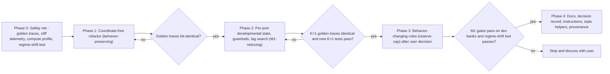

# Coordinate-Free Architecture and Principled Parameter Scaling Plan

**Date:** 2026-11-08 (updated 2026-11-13)  
**Status:** **Completed, historical.** The coordinate-free Phases 1–4 refactor is committed (`deb200a` on top of `2d009b0` `tag: m1-final-lattice`). The canonical constants inventory has moved to [parameter_inventory.md](parameter_inventory.md) (referenced by `.github/copilot-instructions.md` Rule 2), and remaining implementation gaps / M2 readiness items are tracked in [pre_milestone_2_readiness_plan.md](pre_milestone_2_readiness_plan.md).  
**Scope:** Separate graph morphogenesis from the retired 2D grid. Replace ungrounded scalar constants with scaling rules, or reclassify them explicitly. Make every remaining limit observable, so that parameter cliffs show up instead of failing silently.

---

## Executive summary

Milestones 1a and 1b showed the core hypotheses hold:

1. **H1 (Metabolic selection):** Prequential calibrated reward plus one-time description debt $\Delta L_i$ gives exact micro/macro MDL conservation ($\Delta E = -\Delta L_{\text{null}}$, measured on cumulative flux).
2. **H2 (Residual neurogenesis):** Online mutual-information residual diagnosis, causal $z^{-\tau}$ delay recruitment, and stacked finite-ring correctors drive clean error to zero. They also close autonomous recurrent loops at the Bayes noise floor without backpropagation.

The friction in both milestones came from two kinds of technical debt, not from the theory:

1. **The leftover 2D coordinate grid.** M0's cellular-automaton metaphor left behind a 64-cell ceiling, perimeter anchor crowding, and coordinate placement code. Under the default `WellMixed` topology the compute engine throws all of this away at lowering.
2. **Ungrounded scalar constants.** Values such as `max_energy_reserve = 25.0`, `max_nodes = 32`, reactive lags `τ ≤ 3`, and per-bank pass hurdles had no scaling justification. Several of them collided with debt amortization times, bit widths, or multi-channel needs, and **they failed silently when they bound**.

Revision 2 changes how the work is run, not what it aims at:

* **Verify before changing.** A golden-trace harness (Phase 0) must exist before any refactor. Grid removal and the multi-channel generalization must then reproduce M1 trajectories **bit for bit** under `WellMixed`. Behavior-changing parameter rules come last, each with its own re-baseline.
* **Observe before tuning.** Every cap, guardrail, and window emits telemetry when it binds. The M1 friction came from cliffs that nobody could see.
* **Classify, then ground.** Every constant is listed in a single inventory (§2.1) as *derived*, *pre-registered scientific parameter*, or *compute guardrail*. Free multipliers inside "derived" rules (the draft's `β = 2.0`, `N_channel = 16`) are magic numbers under another name. They are removed or turned into explicit decisions.
* **Reuse, don't duplicate.** `substrate::Circuit` is already a coordinate-free directed multigraph. It becomes the single topology representation, and no parallel `GraphCircuit` type is built.

---

## 1. Removing the 2D grid

### 1.1 What does the 2D grid add today?

**Under the default `WellMixed` regime, nothing behavioral.**

M0 assumed spatial locality meant nearest-neighbour routing on a planar substrate (`LocalVonNeumann` with single-cell `SPLIT` relays). As documented in [Charter v3 §3.1.1](foundational_research_charter_v3.md#311-coordinate-free-graph-connectivity) and Decision Record #29, planar relays congested the output ports and blocked multi-stage neurogenesis. The M1b closeout review measured this directly ([research_record.md §2.5](research_record.md#25-redesigned-m1a--milestone-1-attainment-sign-offs-2026-11-072026-11-08)). Charter v3 therefore pivoted to:

* **Direct point-to-point wiring** (`WellMixed`) as the default.
* **Locality priced by description length:** $L_{\text{wire}} = \log_2(S \times D)$ bits per edge, plus explicit `SPLIT` taxes in [`circuit_code_bits_with_tax`](../src/metrics/mdl.rs). Under `WellMixed` this code length is already independent of coordinates, because `placement_bits_per_node = 0` and the wire cost uses port counts only.

### 1.2 Why the grid was removed

The Phase 1 refactor deleted the leftover spatial data structures (`LatticeCircuit` in retired `src/structural/lattice.rs`, 1,956 lines including tests; `EditableLattice` → [`EditableCircuit`](../src/structural/surgery.rs)):

1. **Hard 64-cell ceiling.** `GridShape::new(8, 8)` required every node to occupy an empty cell (`place_node`, `nearest_empty_cell`, `best_empty_cell_between`), failing with `NoSpace`/`UnknownEndpoint` at node 65 even under `WellMixed`.
2. **Perimeter anchor bookkeeping.** `default_anchors` (~110 lines) existed only to assign boundary ports coordinates.
3. **Code surface.** [`growth.rs`](../src/structural/growth.rs) alone held ~170 `Coord`/`LatticeCircuit`/`max_relay_hops` references across candidate materialization, BFS const-loop search, rectangular ring placement, and ring rebuilding, alongside dependents in `verify_m1/`, `config.rs`, `metrics/mdl.rs`, and four integration test suites.
4. **Misleading failure modes & unused arguments.** `LatticeError::NoSpace`, `UnknownEndpoint`, and `max_relay_hops` invited coordinate-placement heuristics for an abstraction with zero behavioral effect under `WellMixed`.

### 1.3 The replacement: `substrate::Circuit` as the only topology

`substrate::Circuit` ([`circuit.rs`](../src/substrate/circuit.rs)) stores `Vec<Primitive>` indexed by `NodeId(u32)` and `Vec<Edge { src, dst, hops }>`, enforcing invariants in `compile()`. Rather than duplicating it:

* **Substrate additions (pure graph operations, integer-only, no new dependencies):** `disconnect(src, dst)`, `replace_edge_source`, and `remove_nodes(&BTreeSet<NodeId>) -> Vec<Option<NodeId>>` (stable, order-preserving compaction).
* **Structural policy helpers** (`tap_source` with automatic `SPLIT` insertion, `stack_output_binary_op`, const-loop and ring materialization) live as free functions over `&mut Circuit` in [`graph_edit.rs`](../src/structural/graph_edit.rs). They encode growth policy, not substrate semantics.
* **`EditableLattice` → `EditableCircuit`**, wrapping `Circuit`, `CompiledCircuit`, `ScalarState`, and `EconomyState`. `recompile_preserving_state` stays the single transactional edit path.
* **Timing:** combinational wires, with registers only as explicit `Primitive::Delay` nodes. Under the `TicksPerHop` ablation, every edge carries `hops = 1`.
* **Determinism constraint:** edit helpers must preserve **node and edge insertion order** so node indices, feature names, candidate tie-breaking, and sensitivity sampling remain deterministic.

> [!NOTE]
> Addressable internal comparator sinks (`SignalSink::InternalComparator`) are an M2/M4a requirement ([research_record.md](research_record.md) §6.2; [pre_milestone_2_readiness_plan.md](pre_milestone_2_readiness_plan.md) **Q5**). They remain deferred to M2 planning; per-port developmental state and scorers key by a sink index type ready to grow a comparator variant cleanly.

### 1.4 Retirement of spatial ablations

Removing the grid retired the pre-registered `LocalVonNeumann`/`LocalMoore` spatial ablations:

| Pre-registered artefact | Location | Action |
| :--- | :--- | :--- |
| `G1B.4a` Axis 3 (spatial locality vs. `WellMixed`) | [`verify_m1/m1b.rs`](../src/verify_m1/m1b.rs) | Retired (archived at `m1-final-lattice`) |
| M1a spatial case `Add(Osc2, ConstLoop(0))` on `LocalVonNeumann` | [`verify_m1/mod.rs`](../src/verify_m1/mod.rs) | Retired (archived at `m1-final-lattice`) |
| Spatial unit and integration tests | Removed `lattice.rs`, `surgery.rs`, `learner.rs`, `tests/` | Deleted or ported to `WellMixed` |
| `grid_rows`, `grid_cols`, `max_relay_hops`, `wiring_topology` config fields | [`config.rs`](../src/config.rs) | Removed |

Retirement protocol: (1) Charter Decision Record #30 makes topology retirement structural and closes the spatial ablation. (2) Commit tag `m1-final-lattice` (`2d009b0`) anchors historical spatial reproduction. (3) Durable attainment metrics and retirement records are preserved in [research_record.md](research_record.md) §2.5.

---

## 2. Parameters: classification, observability, and scaling rules

### 2.0 Rules that apply to every parameter

1. **Classification.** Each constant is exactly one of:
   * **Derived:** computed from other quantities with no free multiplier.
   * **Pre-registered scientific parameter:** a free value that is justified in the Charter or a milestone plan, fixed before data is collected, and backed by a recorded sensitivity sweep.
   * **Compute guardrail:** exists only to bound runtime. It must **never bind in an accepted run**. If it binds, the run is flagged and does not count.
2. **Observability.** Every cap, guardrail, clip, or window truncation increments a named telemetry counter when it binds, for example `SproutBlocked::MaxNodes`, `ReserveClipped { bits }`, or `CandidateUndecidable`. Verification harnesses report these counters, and guardrail counters are asserted to be zero.
3. **Reduction to M1.** Where possible, a new rule must reduce *exactly* to M1 behavior at M1 configurations (`K = 1`, `k ∈ {1, 2}`). That makes it checkable by golden traces. A rule that cannot reduce this way is behavior-changing and goes in Phase 3.
4. **No post-hoc fitting.** Choosing a multiplier because it "recovers the historical constant" is fitting, not grounding. Any rule that still has a free multiplier is a pre-registered parameter and needs a sensitivity sweep.

### 2.1 Constants inventory (historical snapshot; migrated to [parameter_inventory.md](parameter_inventory.md))

*Historical audit snapshot migrated to [parameter_inventory.md](parameter_inventory.md) under Readiness `C4`. Retain this table read-only as part of the completed Phase 1–4 specification; update [parameter_inventory.md](parameter_inventory.md) for active work.*

| Constant | Current value / location | Class | Target Action | Implementation | Evidence / Next Step |
| :--- | :--- | :--- | :--- | :---: | :--- |
| Grid shape | Removed (`lattice.rs` deleted) | Leftover | Delete (§1) | Done (uncommitted) | Pending Phase 1/2 `A1`–`A2` provenance check |
| `max_relay_hops` | Removed (`config.rs`, `growth.rs`) | Leftover | Delete (§1) | Done (uncommitted) | Pending `A1`–`A2` |
| `max_energy_reserve` | `juvenile_ticks + 128.0` (`W_obs` mismatch + hardcoded `128.0`), [`economy.rs`](../src/structural/economy.rs) | Pending **Q1** (Option B candidate vs. alternatives) | Single `W_obs` helper + user decision **Q1** (§2.2) | Partial (`F2`–`F5`) | Pending `Q1`, `B1`, `B6`, `A4` |
| `max_nodes` | `32`, [`growth.rs`](../src/structural/growth.rs) | Compute guardrail | Single `node + motif <= max_nodes` check + harness zero-assert (§2.3) | Partial (`F6`, `F7`, `F10`) | Pending `B3`, `B4`, `B5`, `Q3` |
| Global juvenile sprout freeze | Per-port `PortDevelopmentalState`, [`learner.rs`](../src/structural/learner.rs) | Multi-channel defect fix | Per-port maturity/diagnostics/snapshots + lock-time test (§2.4) | Partial (`F11`, `F12`) | Pending `B7`, `Q4` |
| `obs_window` capacity | `juvenile + 2·W_diag = 256`, [`learner.rs`](../src/structural/learner.rs) | Derived | Unify with `observation_horizon`, assert `CandidateUndecidable` (§2.5) | Partial (`F3`, `F7`) | Pending `B1`, `B3` |
| Miller–Madow alphabet | Empirical support, [`growth.rs`](../src/structural/growth.rs) | Verified fix | Active; `W_diag` scaling deferred to M5 (§2.6) | Done | Covered by M1b hardening & dev suites (`A5`) |
| Reactive lag horizon | Literal `max_tau = 3` / `1..=3` in [`learner.rs`](../src/structural/learner.rs) & [`growth.rs`](../src/structural/growth.rs) | Search bound (candidate) | Either deepening (§2.7) or config bound + telemetry (`B2` / **Q2**) | Not started (`F1`) | Pending `Q2`, `B2` |
| Candidate feature cap | Literal `.take(6)` in [`growth.rs`](../src/structural/growth.rs) | Search bound (candidate) | Config field + `CandidateListTruncated` harness wiring | Not started (`F1`, `F7`) | Pending `Q2`, `B2`, `B3` |
| Ring period search range | Literal `2..=6` in [`growth.rs`](../src/structural/growth.rs) | Search bound (unlisted in config) | Config field + `RingPeriodBound` telemetry (`B2`) | Not started (`F13`) | Pending `Q2`, `B2` |
| Candidate tie-break threshold | Literal `1e-9` in [`growth.rs`](../src/structural/growth.rs) | Numerical tie-break (unlisted) | Document or parameterize (`F13`) | Unlisted (`F13`) | Pending `B2` / `C4` |
| `juvenile_ticks` | `128` (`EconomyConfig`) | Pre-registered (M1) | Kept; unclipped escrow & maturity settlement | Pre-registered | M1 sign-offs in [research_record.md](research_record.md) §2.5 |
| `diagnostic_window` | `64` (`GrowthConfig`) | Pre-registered (M1) | Kept | Pre-registered | Same |
| `sprout_interval` | `32` (`GrowthConfig`) | Pre-registered (M1) | Kept | Pre-registered | Same |
| `mi_threshold_bits`, `min_match_gain` | `0.05`, `4` (`GrowthConfig`) | Pre-registered (M1) | Kept | Pre-registered | Same |
| `initial_energy` | `4.0` (`EconomyConfig`) | Pre-registered (M1) | Kept | Pre-registered | Same |
| `trace_discount` γ | `0.90` (`EconomyConfig`) | Pre-registered (Charter DR #26) | Kept | Pre-registered | Same |
| Sensitivity `sample_count` | `8` struct literal in [`learner.rs`](../src/structural/learner.rs) | Pre-registered (M1, `k > 1` only) | Kept (`F13`: move from literal into config/docs) | Partial (`F13`) | Pending `C4` |
| KT prior mass in `q̂` | `½·2^k` pseudo-counts, [`point_forecast.rs`](../src/metrics/point_forecast.rs) | Derived (symbol-level KT) | Kept | Derived | [point_forecast.rs](../src/metrics/point_forecast.rs) |
| Stage-gate statistics | Pooled Clopper–Pearson 99% + χ² homogeneity, [`verify_m1/stats.rs`](../src/verify_m1/stats.rs) | Derived | Ready for M2 pre-registration (**Q9**) (§2.8) | Done (uncommitted) | Pending `Q9` for M2 gate targets |

### 2.2 Energy reserve ceiling $E_{\max}$

#### What the cap is for

[Charter §3.1.2](foundational_research_charter_v3.md#312-metabolism) says mature reserves are bounded "so obsolete structures cannot coast indefinitely after regime shifts." So the cap sets an **adaptation latency**: an obsolete node needs about $E_{\max} / \text{drain rate}$ ticks to starve. Any principled rule has to be derived from that purpose. **No current test exercises a regime shift**, so whatever value is chosen is unvalidated today.

#### Corrections to the draft

1. **The O(k) loss claim does not hold under `CalibratedPointForecast`.** A mismatch costs $\log_2\frac{1-q}{1-p}$. That is set by the predictor's confidence $q$ (roughly its running hit rate) and is about $\log_2 \varepsilon$ under substitution noise $\varepsilon$, whatever the width. Width enters the **hit** reward $\log_2(q/p)$ through $p \sim 2^{-k}$. A confident predictor that suddenly becomes wrong loses about $\log_2(t)$ bits per tick, which grows with its match history, not with $k$.
2. **$k / \ln 2$ has no derivation.** The quantities are already in bits, so the $\ln 2$ factor is spurious. The stated burst length $\ell \approx 3\text{–}5$ never appears in the formula.
3. **$\beta = 2.0$ "recovering 25.0" is post-hoc fitting.** Real per-node debts are not 12.5 bits. For example, `Split` owes about 13.75 bits ([research_record.md §3.3](research_record.md)), and debts grow with graph size because $\log_2(S \cdot D)$ does.
4. **Plumbing.** Per-node $\Delta L_v$ lives in [`MarginalDebtLedger`](../src/structural/surgery.rs) (and again in [`LiveCircuit`](../src/structural/live.rs) description debts), not in `EconomyState`. A debt-dependent cap needs the debt to move into `NodeEconomy`, which also removes the duplicate copy.

#### Plan

1. **Phase 0, measure:** add `ReserveClipped { node, bits }` telemetry and report clip counts and clipped bits across the M1 development suites. If the 25-bit cap **never binds** in M1, any replacement that only loosens it is M1-neutral.
2. **Phase 0, add the missing test:** a regime-shift integration test. A circuit locks to task A, then the stream switches to task B, and the test records the ticks until the obsolete cone starves and a replacement sprouts. This test is what validates any $E_{\max}$ rule.
3. **Phase 3, decide (requires user sign-off under the magic-number rule). Candidate rules:**
   * **(A) Debt-proportional cap:** $E_{\max}(v) = \beta \cdot \Delta L_v$. Simple, but $\beta$ is a pre-registered free parameter and needs a sweep (for example $\beta \in \{1, 2, 4\}$) showing the gates do not depend on it.
   * **(B) Horizon-derived cap:** $E_{\max}(v)$ equals the share-weighted loss node $v$ would take over $H$ consecutive mismatches at its port's current confidence $q$, with $H$ tied to an existing lifecycle quantity (for example $W_{\text{obs}}$: the system cannot judge a replacement faster than it can observe one). This adapts to $k$, $\varepsilon$, and confidence, has no free multiplier, and guarantees obsolete nodes starve within about $H$ ticks.
   * **(C) Exponential reserve forgetting** with time constant $H$ in place of a hard cap.

   All three leak energy just as clipping does today. Conservation stays measured on cumulative flux, which is how the current telemetry already does it.

### 2.3 Node limit $N_{\max}$

The draft's $N_{\max} = K \times 16$ replaces one magic number with another. At $K = 1$ it would also **halve** the current M1 limit (32 → 16) and change behavior without saying so.

**Rule:** `max_nodes` is a **compute guardrail**, not a developmental parameter. Growth is meant to be limited by MDL debt and calibrated flux.

* Check `node_count + motif_size <= max_nodes`. Readiness Finding `F10` notes [`learner.rs`](../src/structural/learner.rs) still retains the pre-check `node_count < max_nodes` and mixed `>=`/`>` comparisons (tracked for cleanup in Readiness `B4`).
* Emit `SproutBlocked::MaxNodes`. Verification harnesses assert it is zero, and a run where it binds is flagged and excluded.
* Set the value from the Phase 0 compute profile (per-tick cost against $N$ and $K$), not from a per-channel node estimate. At M1 sizes (≤ 9 nodes observed) any value ≥ 32 is M1-neutral.

### 2.4 Per-port developmental state (cone-local maturity)

#### The problem is wider than the juvenile check

The draft scopes only the juvenile check to the target port's cone. Channel-isolated development needs **all** of the following, which are global in `HEAD`:

| Global coupling in `ArkheLearner::observe` | Effect at $K > 1$ |
| :--- | :--- |
| `all_mature` over every node ([`learner.rs`](../src/structural/learner.rs)) | Any juvenile node freezes diagnosis and sprouting on every channel |
| One `post_juvenile_diag` buffer, cleared on *any* sprout or prune | One channel's edit throws away every other channel's diagnostic evidence |
| One `ticks_since_last_check` timer, plus `break` after the first sprouting port | Serial development, plus a port-index bias (port 0 always gets first chance) |
| `all_driven_ports_primed` over every port | One unprimed `TicksPerHop` chain blocks every channel |
| Epoch snapshots hardcoded to port 0 / `sprout_events == 2` | No per-channel G1B.1-style evidence |

#### Rule

Each output sink $p$ carries its own `DiagnosticBuffer`, sprout timer, primed flag, and maturity gate:

$$\text{CanSprout}(p) \iff \forall v \in \text{UpstreamCone}(p),\ \text{juvenile}(v) = 0$$

In addition:

* **Exclude features sourced from juvenile nodes** from port $p$'s signal pool. Without this, cross-channel taps (`node:*` features from channel $A$'s cone feeding a candidate on $B$) would build on structure that is still settling, which is what the juvenile freeze was meant to prevent.
* A structural edit clears only the buffers of ports where [`port_cone_changed`](../src/structural/surgery.rs) is true. That predicate already scopes scorer resets.
* Keep **at most one committed structural edit per tick** for transactional simplicity, but rotate the starting port (`tick mod K`) to remove port-index bias.

**M1 reduction:** at $K = 1$ every live node sits in port 0's cone, so the per-port state matches the global state exactly. This step is therefore covered by the golden-trace gate. **New acceptance test:** $K$ independent single-channel tasks run side by side should each lock within the single-channel tick budget, not $K$ times later.

### 2.5 Observation window $W_{\text{obs}}$: horizon unification pending `B1` / `B3`

[`ArkheLearner`](../src/structural/learner.rs) already sets `obs_capacity = juvenile_ticks + 2 · diagnostic_window` (256 ticks), introduced in the post-review hardening ([research_record.md §2.5](research_record.md)). (`economy.rs` currently uses `juvenile_ticks + 128.0` for Option B; unifying both behind one helper is tracked in Readiness `B1` / `Q1`.)

**Correction:** the rule does **not** guarantee $W_{\text{obs}} \ge W^*$ in general. $W^* = \Delta L / \Delta I$ depends on the candidate's debt, the noise level, the width, and the motif size. The draft's "every candidate capable of surviving is recognized" holds only for the measured `NoisyAlternating(k=1)` case ($W^* \approx 152.9$).

**Remaining work (`B3`):** `CandidateUndecidable` exists in learner telemetry, but `verify-m1` harnesses do not yet aggregate or report it (Readiness `F7`).

### 2.6 Miller–Madow support: implemented; estimator scaling deferred to M5

[`score_feature_group`](../src/structural/growth.rs) already uses the empirical support of both the joint feature alphabet and the residual alphabet.

**Correction:** the draft's claim that empirical support "guarantees that the bias penalty can never exceed the empirical entropy" is false. With $N = 64$ and all-distinct values, $(63 \cdot 63)/(2 \cdot 64 \ln 2) \approx 44.7$ bits, against an entropy of $\log_2 64 = 6$ bits. $\min(N, |\text{Unique}|)$ is also redundant, since unique values never exceed $N$.

**The real scaling issue (M5):** a fixed $W_{\text{diag}} = 64$ undersamples large joint alphabets. The reliability of any plug-in MI test depends on $N / (|\hat{\mathcal A}_X||\hat{\mathcal A}_R|)$. Two options, to be decided in the M5 plan with width-sweep evidence:

1. Scale $W_{\text{diag}}$ with observed joint support.
2. Replace the triple (`mi_threshold_bits`, Miller–Madow, `min_match_gain`) with a single **prequential code-length gain** test: the KT-coded residual given the feature against the residual alone. This charges for model complexity automatically, fits the project's MDL foundations, and removes two pre-registered constants.

### 2.7 Reactive lag horizon and candidate caps (pending `Q2` / `B2`)

> *Status:* Not yet implemented (`max_tau = 3` and `.take(6)` remain literal constants in the working tree; see Readiness `F1` and `Q2`/`B2`).

The executive summary listed `τ ≤ 3` as a cliff, which was the root cause of the sparse `PeriodicMotif([0,0,0,0,0,1])` stall ([research_record.md §3.3](research_record.md)) that autonomous ring closure later bypassed.

**Rule:** a lag horizon is a **search bound**, not a model constraint. Every materialized `Delay` is already priced by $L(C)$.

* Search lags by iterative deepening ($\tau_{\max} = 1, 2, 4, \dots$) only while no feature passes the growth criterion. Stop at `TickBudget` exhaustion or $\tau_{\max} \ge W_{\text{diag}}/2$, where the remaining sample count makes the MI estimate meaningless.
* Apply the same treatment to `.take(6)` candidate features and to lagged residual MI over lags `1..=3`.
* Emit `LagHorizonBound` (`LagHorizonExhausted`) and `CandidateListTruncated` when bounds fire (Readiness `B2`).

**M1 reduction:** run the deepening only when the `τ ≤ 3` pass finds nothing. M1 trajectories that sprouted with `τ ≤ 3` then stay identical. Runs that stalled (such as sparse $p = 6$) can now change, so this step needs a targeted test and does not rely on the golden trace alone.

### 2.8 Multi-bank statistical acceptance: pooled confidence bounds

The draft's arithmetic holds: $P(\text{Bin}(20, 0.95) \ge 18) = 0.9245$, and $0.9245^{100} \approx 0.04\%$. A per-bank hurdle applied across many banks is a compound filter that rejects reliable algorithms.

**Rule (to be pre-registered in the M2 plan before any M2 data is collected; M1 results are not re-scored):**

1. **Pooled success:** the one-sided 99% Clopper–Pearson lower bound on the pooled success rate over all $N = M \times B$ seeds must be $\ge P_{\text{target}}$. The draft's extra slack term $\epsilon$ is dropped as an unanchored constant.
2. **Homogeneity:** a $\chi^2$ test of equal success rates across banks at the same 1% level. Bank mean, standard deviation, and 5th percentile are reported. Clustered failures (rejected homogeneity) fail the gate even if the pooled bound passes. This gives "distributional stability" a falsifiable criterion.
3. Implement both as reusable helpers in `verify_m1/` (or a shared `verify` statistics module) in Phase 4, so that M2 and later harnesses use them instead of re-implementing them.

---

## 3. Engineering roadmap

### Phase 0: Safety net (no behavior change)

1. **Golden-trace harness** (`tests/golden_traces.rs` plus `tests/fixtures/golden/`):
   * For every `WellMixed` learner configuration used by the M1a/M1b gates (both wire-delay modes, $k \in \{1, 2\}$, development seeds only), record a compact **event log**: tick and kind of every sprout, prune, and ring closure, plus the final `Circuit` edges. Also record a **trajectory digest**: FNV-1a over per-tick predictions, `structure_epoch`, and `f64::to_bits` of every node reserve.
   * Regenerate with an explicit bless switch (for example `ARKHE_BLESS=1 cargo test --test golden_traces`). On mismatch, report the **first divergent tick and event** so that a divergence is quick to localize.
   * Never use holdout seeds `10000..=10019`.
2. **Cliff telemetry** (counters only, M1-neutral): `ReserveClipped`, `SproutBlocked::MaxNodes`, placement `NoSpace` (until Phase 1 removes it), `CandidateUndecidable`, `CandidateListTruncated`. Surface them in `ArkheM1Telemetry` and the `verify-m1` summaries.
3. **Baseline measurements:** run the M1 development suites and record which limits bind and how often. Profile per-tick cost (sensitivity, diagnosis, candidate replay) against node count and channel count. This identifies M2's real compute bottleneck, which is most likely the $O(F^2)$ feature-pair scoring in `diagnose_residual` and per-node counterfactual sensitivity. Grid search is unlikely to matter, since `WellMixed` already avoids routing.
4. **Regime-shift test** (§2.2). It may fail today. Its job is to measure, not to gate.

**Exit:** fixtures committed, telemetry merged, measurements written into §2 of this document.

### Phase 1: Coordinate-free refactor (behavior-preserving)

Work in place, strangler-style: delete coordinate code path by path rather than rewriting from scratch, so the golden traces localize any regression.

1. Retire the spatial ablations following the §1.4 protocol (tag the commit, add Decision Record #30, add the plan addendum).
2. Add the `Circuit` mutation primitives (§1.3) with unit tests: order preservation, remap correctness, and invariant checks via `compile()`.
3. Port `EditableLattice` → `EditableCircuit`, then port `growth.rs` materialization (`materialize_source`, `materialize_const_loop`, motif and ring builders, `build_autonomous_ring_lattice`) and `MarginalDebtLedger` to `Circuit` plus `graph_edit.rs`. Keep insertion order identical.
4. Delete `lattice.rs`, `GridShape`, `Coord`, `PerimeterSide`, `BoundaryAnchor`, `default_anchors`, `WiringTopology` and the topology/grid parameters of the MDL functions, `max_relay_hops`, and the matching config fields. Update `README.md` and the CLI tests.

**Exit gate:** golden traces bit-identical; `cargo fmt --check`, `cargo clippy --all-targets --all-features -- -D warnings`, and `cargo test --locked` pass; `verify-m0` and `verify-m1` pass on development seeds, minus the retired cases.

> [!NOTE]
> **Readiness A1 evidence (Phase 1–2 bit-identical under the M1 cap):**
> Verified on `2026-11-13` by extracting the 8 Phase 0 golden fixtures from `2d009b0` (`git archive 2d009b0 tests/fixtures/golden | tar -x -C /tmp/arkhe_phase0_golden`), temporarily overriding `EconomyConfig::default()` with `ReserveCap::Fixed(25.0)` and pointing `tests/golden_traces.rs` at the extracted fixtures, then running `cargo test --test golden_traces -- --nocapture`. Observed output: `running 1 test`, `test golden_traces_are_bit_identical ... ok`, `test result: ok. 1 passed; 0 failed; 0 ignored; 0 measured; 0 filtered out; finished in 15.83s`. After reverting those two temporary test overrides, the working-tree `HorizonDerived` fixtures also passed `cargo test --locked` (all unit and integration suites green). This isolates the re-blessed trajectory digest deltas strictly to Phase 3 (`ReserveCap::HorizonDerived`).

### Phase 2: Multi-channel generalization (reduces to M1 at `K = 1`)

1. Per-port developmental state, juvenile-feature exclusion, and port rotation (§2.4), keyed by a sink index that can later hold comparators (§1.3 note).
2. `max_nodes` guardrail semantics (§2.3) and the lag/candidate search bounds (§2.7).
3. Per-port epoch snapshots, replacing the port-0 hardcoding.

**Exit gate:** `K = 1` golden traces identical (except the documented §2.7 stall cases, which are covered by their own tests). The new `K ≥ 2` concurrent-development test passes. Guardrail counters are zero.

### Phase 3: Behavior-changing rules (requires user decision)

1. Move per-node $\Delta L_v$ into `NodeEconomy`, removing the duplicate debt tables.
2. Implement the $E_{\max}$ rule chosen from §2.2 (A/B/C).
3. Re-run the M1 gates on development banks (pass/fail, not bit-identity) and the regime-shift test. Re-bless the golden traces **with a written rationale in the commit message**. Record the new `source_tree_fnv1a128` and evaluate on a fresh disjoint confirmation bank. The holdout stays untouched.

### Phase 4: Documentation, instructions, provenance

1. Charter: Decision Record #30 (grid retirement) and an updated §3.1.2 design note naming the chosen reserve rule.
2. Pooled-statistics helpers (§2.8), referenced from the M2 pre-registration.
3. Instructions amendment (§4).
4. Update this document's inventory (§2.1) with the final status of every row.

---

## 4. Instructions status

The `Architectural Integrity & Parameter Discipline` block proposed here was applied to `.github/copilot-instructions.md` (`GEMINI.md`). Its proposed expansion (Rule 5 and Rules 7–11) lives in [pre_milestone_2_readiness_plan.md](pre_milestone_2_readiness_plan.md#43-proposed-amendment-to-githubcopilot-instructionsmd).

---

## 5. Risk register

| Risk | Mitigation |
| :--- | :--- |
| A refactor silently changes node or edge order and therefore tie-breaking | Golden traces with first-divergence reporting (Phase 0); order-preservation unit tests for `Circuit` mutations |
| Retiring spatial gates looks like moving goalposts | Decision Record #30, tagged reproduction commit `m1-final-lattice`, and [research_record.md](research_record.md) §2.5 (§1.4) |
| A reserve-cap change destabilizes M1 halting or noise-floor behavior | Phase 0 measures whether the cap binds; regime-shift test; Phase 3 is gated on user sign-off (`Q1`) and a full M1 dev-bank re-run |
| Per-port development exposes cross-channel juvenile tapping | Juvenile-feature exclusion (§2.4) |
| M2 hits compute limits rather than structural limits | Phase 0 / Readiness `B5` compute profile; `max_nodes` set from measured cost (`Q3`); guardrail counters asserted zero |
| Scope creep into M2 features (comparator sinks, redundancy protection) | Explicitly deferred to M2 planning after Readiness `Q5`–`Q9`; Phase 2 keeps the sink index extensible |
